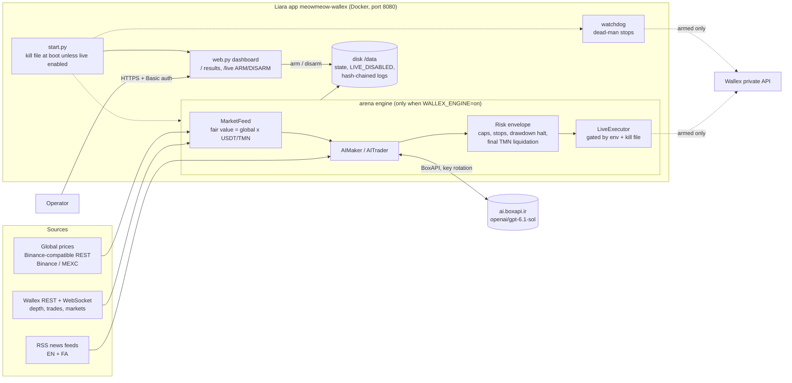

# Wallex AI Trader

[](https://github.com/moazeniz/wallex-ai-trader/actions/workflows/ci.yml) [](https://github.com/moazeniz/wallex-ai-trader/actions/workflows/deploy.yml) [](https://meowmeow-wallex.liara.run) [](https://negahban-sre.liara.run/status)  

> **خلاصه‌ی فارسی:** این مخزن موتور معاملات الگوریتمی تیم MeowMeow برای چالش «معاملات الگوریتمی هوشمند والکس» است.
> چند استراتژی (قانون‌محور و مبتنی بر مدل زبانی) به‌طور هم‌زمان روی دفتر سفارش زنده‌ی والکس اجرا می‌شوند، هر کدام با حساب
> کاغذی جداگانه، لایه‌ی ریسک قطعی، لاگ تصمیم زنجیره‌ای (hash-chained) و تسویه‌ی نهایی به تومان. نسخه‌ی تولیدی روی
> **لیارا** (`meowmeow-wallex`) با داشبورد رمزدار اجرا می‌شود و مدل زبانی فقط از طریق **BoxAPI** فراخوانی می‌شود.
> موتور معاملاتی به‌صورت پیش‌فرض **خاموش و غیرمسلح** است و فقط با چند کلید ایمنی (متغیرهای محیطی + حذف فایل
> `LIVE_DISABLED` از صفحه‌ی `/live`) سفارش واقعی ثبت می‌کند.
>
> **Project guide / راهنمای کامل پروژه:** [English](docs/PROJECT_GUIDE.en.md) · [فارسی](docs/PROJECT_GUIDE.fa.md)

An AI-led, risk-bounded algorithmic trading system for the **Wallex** (Iranian crypto exchange, TMN markets)
algorithmic-trading challenge. Several strategies — rule-based market making / lag reversion and LLM traders — run
side by side on **one shared live market feed** ("the arena"), each with its own paper account, so they can be compared
fairly before any capital is put at risk. A deterministic risk envelope enforces position, exposure, stop, drawdown and
final-settlement rules no matter what a strategy or model proposes, and every decision is written to a tamper-evident
log.

**Production** is the Liara app **`meowmeow-wallex`** (`https://meowmeow-wallex.liara.run`): a password-protected
dashboard with the paper/shadow results and a live-engine control page. The live engine is deployed **idle and
disarmed**; the LLM goes through **BoxAPI** (`openai/gpt-6.1-sol`, key rotation). Read
[Safety](#safety-read-before-going-live) before going live.

## Tests & benchmarks · تست‌ها و بنچمارک

> خلاصه: بک‌تست ۷ روزه نشان می‌دهد قیمت والکس از قیمت جهانی عقب می‌ماند (همبستگی ‎−0.367‎ با حرکت ۵ دقیقه‌ی بعد در ۲۹ بازار)؛ ۱۷ حساب کاغذی روی دفتر سفارش زنده‌ی والکس بدون سفارش واقعی مقایسه می‌شوند؛ ۴۷۴ تست آفلاین در CI پاس شده‌اند.

| What | Result | Source |
|---|---|---|
| Backtest: Wallex lags the global price (7 days of 1-minute candles, 29 markets) | median correlation of the gap with the next 5-minute Wallex move **−0.367**; best rule **+21.3%** summed per-trade return over 53 trades, positive in 8/10 markets (in-sample; the shadow test is the out-of-sample check) | [docs/results/README.md](docs/results/README.md) |
| Shadow test on live Wallex order books (no real orders), 17 paper accounts × 5,000,000 TMN with level-1 fees | best account **+0.013%**; BTC hold benchmark −0.320%; every account's max drawdown below 2% | [docs/results/README.md](docs/results/README.md) · [shadow-equity.png](docs/results/shadow-equity.png) |
| AI decisions in the arena | 317 Haiku calls ($0.59 total) and 46 Opus calls ($3.63 total), each decision written to a hash-chained log | [docs/results/README.md](docs/results/README.md) · [docs/components/arena.md](docs/components/arena.md) |
| Automated tests (offline, no network, no keys) | **474 passed**, 4 skipped | [green CI run](https://github.com/moazeniz/wallex-ai-trader/actions/runs/39963830886) |

Reproduce: `make install-dev && make test` · `make arena-report STATE=<arena state dir>` rebuilds the shadow-test report from the saved ledgers.

## How we use Wallex MCP/API

- **Wallex MCP (official server, `https://api.wallex.ir/mcp`):** the AI's research step and the dashboard page `/market`
  get candles (several resolutions), order-book depth, recent trades and market/ticker data through four public,
  read-only MCP tools. No API key is sent, and every account, order, margin or credit tool is refused before any
  network call.
- **Fallback:** if the MCP server is unavailable, the same data comes from Wallex public REST (marked `source: rest`).
  Every call is logged as `mcp.call`.
- **Wallex public WebSocket + REST:** the engine's live order books and trades (low latency).
- **Wallex private REST:** orders, cancels and balances, and only when live trading is armed. MCP is never used for
  trading.
- Details and the tool list are in [DEPLOYMENT.md](docs/DEPLOYMENT.md#how-we-use-wallex-mcpapi).

## Contents

- [Architecture](#architecture)
- [Features](#features)
- [Quick start](#quick-start)
- [Configuration](#configuration)
- [Tests](#tests)
- [Deployment](#deployment)
- [Safety (read before going live)](#safety-read-before-going-live)
- [Project structure](#project-structure)
- [Security notes](#security-notes)
- [Team](#team)

## Architecture



The same engine also runs **self-hosted** (optional) as hardened systemd units for long paper/shadow runs:

| Unit | Entry point | Mode | Purpose |
|---|---|---|---|
| `wallex-arena` | `python -m experiments.wallex_arena run CONFIG STATE KEYFILE` | paper (live only per account + switches) | All 17 strategies on one feed, risk envelope, logs |
| `wallex-paper-agent` | `python -m experiments.wallex_agent serve ...` | **paper only** (no order transport exists) | Frozen XGBoost/Ridge forecasts + news + 3-role council, shared 5M TMN paper portfolio |
| `wallex-live-watchdog` | `python -m experiments.wallex_arena.watchdog STATUS STATE` | live safety | If the arena goes silent > 120 s, cancels engine orders and places exchange-side stop-loss orders |
| `wallex-book-recorder` | `services/book_recorder.py DB 12` | read-only public data | Records Wallex depth/trades + Binance quotes |
| `wallex-dashboard-export` (+`.timer`) | `services/dashboard_export.py OUT STATE` | read-only | Every 30 s exports leaderboard/equity/trades JSON |
| `wallex-dashboard-web` | `services/dashboard_server.py PORT DIR` | read-only | Static dashboard over HTTPS with HTTP Basic auth |

Details: [docs/ARCHITECTURE.md](docs/ARCHITECTURE.md).

## Features

- **Arena engine** — one shared live feed (Wallex WebSocket + REST fallback, global prices from a Binance-compatible
  API), tick every 2–8 s, ~45 focus TMN markets; identical data for every strategy.
- **Strategies** — `LagReversion` (Wallex lags global prices; buy large negative gaps, sell at fair value),
  `FairValueMaker` (resting quotes around global fair value, downtrend filter, fixed-market lists e.g. USDC),
  `AITrader` / `AIMaker` (the LLM decides entries, exits, sizes, stops / maker plans), `HoldBenchmark`.
- **LLM providers** — `openai/...` models through **BoxAPI** (`experiments/wallex_arena/boxapi.py`: round-robin key
  rotation, fail-over on 401/402/403/408/409/429/5xx and timeouts, per-key cooldown, strict JSON-schema output, billed
  cost recorded); `claude-*` models through the Anthropic SDK remain available for self-hosted paper runs.
- **Deterministic risk envelope** — max 35 % per position, 95 % exposure, 1 % risk-per-trade sizing, stop + max hold on
  every position, 5 % drawdown pause, 10 % drawdown halt + liquidation, no entries in the final hour, full TMN
  liquidation at `liquidate_at_utc`, 100,000 TMN minimum order (buys and sells), excluded-market list.
- **Realistic paper fills** — taker fills walk the live order book with Wallex fees; maker fills only when real trades
  print through the price.
- **Audit trail** — per-account hash-chained `decisions.jsonl`, SQLite fills/equity, per-call LLM cost ledger with a
  daily USD cap, control audit (`control.jsonl`) for every arm/disarm; `report` builds a Markdown report from logs.
- **Live execution client** — bounded LIMIT orders, own `client_id`s, never-retried POSTs with lookup-based
  reconciliation, 20 orders / 10 s throttle, redacted logging, kill-file + env switch, `dry_run` mode.
- **Liara control plane** — `/live` page: engine state, positions, decisions, errors, read-only balances, AI self-test,
  **Arm** (password + typed phrase) and one-click **Disarm**; connectivity self-check at boot.
- **Dead-man watchdog**, **paper research agent**, **order-book recorder**, self-hosted **dashboard**, templated
  hardened **systemd units**.

## Quick start

Requirements: Linux or macOS, **Python 3.12+** (CI and the Liara image use 3.12/3.14), Docker for the image,
outbound HTTPS to `api.wallex.ir` and a global price API.

```bash
git clone <REPO_URL> wallex-trading && cd wallex-trading
make install-dev            # .venv with runtime + test deps
make test                   # 474 offline tests; no network, no keys

# The production image locally: dashboard only, engine OFF, DISARMED
make docker-build
export WALLEX_ADMIN_PASSWORD=change-me && make docker-run     # http://127.0.0.1:8080/  (user admin)

# Paper arena in the foreground (Ctrl-C to stop), BoxAPI only: use a config copy whose AI accounts have
# "model": "openai/gpt-6.1-sol" (the shipped config's claude-* accounts need an Anthropic key file as ANTHROPIC_ENV)
export BOXAPI_KEYS=<key1,key2> BOXAPI_BASE_URL=https://ai.boxapi.ir/ai/v1
make run-arena ARENA_CONFIG=./my-arena.json STATE=./arena-state ANTHROPIC_ENV=/dev/null
make arena-status STATE=./arena-state && make arena-report STATE=./arena-state
```

The shipped `arena-config.json` is the challenge run (`liquidate_at_utc` = `2026-10-23T19:00:00Z`; its AI accounts use
`claude-*` models). For a BoxAPI-only or rules-only paper run, copy it, set AI `model`s to `openai/gpt-6.1-sol` (or
delete the AI accounts), adjust `liquidate_at_utc`, and pass it with `ARENA_CONFIG=...`.

Other entry points: `make run-agent` / `make agent-status` (paper agent), `make run-recorder`,
`make dashboard-export`, `.venv/bin/python -m experiments.wallex_challenge --help` (earlier baseline).

## Configuration

**Liara app** (set in the Liara console or with `deploy_liara.py setenv`; details in
[DEPLOYMENT.md §A3](docs/DEPLOYMENT.md#a3-environment-variables-and-disk)):

| Variable | Required | Default | Description |
|---|---|---|---|
| `WALLEX_ADMIN_PASSWORD` | **yes** | — | Dashboard Basic-auth password (user `admin`); without it all pages but `/healthz` are refused |
| `BOXAPI_KEYS` | for AI | — | Comma-separated BoxAPI keys (rotation + fail-over) |
| `BOXAPI_BASE_URL` | no | `https://ai.boxapi.ir/ai/v1` | OpenAI-compatible BoxAPI endpoint |
| `WALLEX_MODEL` | no | `openai/gpt-6.1-sol` | Model of the live AI account |
| `WALLEX_ENGINE` | no | `off` | `on` runs the engine + watchdog in the container |
| `WALLEX_LIVE_ENABLED` | live only | `0` | Must be `1` to arm; otherwise the kill file is recreated at every boot |
| `WALLEX_API_KEY` / `WALLEX_SUBACCOUNT_ID` | live only | — | Credit sub-account key and `clientId` |
| `WALLEX_GLOBAL_REST` | no | auto (Binance, else MEXC) | Binance-compatible global-price REST base ([Liara limitation](docs/DEPLOYMENT.md#a9-price-feed-limitation-on-liara)) |
| `WALLEX_SELFHOSTED_URL` | no | — | Extra URL probed by the boot self-check |
| `PORT`, `TZ` | no | `8080`, `UTC` | Listening port, timezone |

**Engine / self-hosted** (complete list from the code; see [.env.example](.env.example)):

| Variable | Required | Default | Used by | Description |
|---|---|---|---|---|
| `BOXAPI_KEYS`, `BOXAPI_BASE_URL` | for `openai/...` models | —, `https://ai.boxapi.ir/ai/v1` | arena AI accounts | As above |
| `WALLEX_LIVE_ENABLED` | live only | unset (= off) | arena live accounts, watchdog | Orders only if exactly `1` **and** the kill file is absent |
| `WALLEX_ENV_FILE` | watchdog | `/opt/wallex/private/wallex.env` | watchdog | `KEY=VALUE` file with `WALLEX_API_KEY`, `WALLEX_SUBACCOUNT_ID` |
| `WALLEX_GLOBAL_REST` | no | `https://api.binance.com` | feed | Binance-compatible REST base; the Binance WebSocket is used only with Binance |
| `WALLEX_EXCLUDED_MARKETS` | no | `experiments/wallex_arena/excluded_markets.json` | book recorder | Organizer-excluded markets |
| `CREDENTIALS_DIRECTORY` | set by systemd | — | dashboard server, paper agent | `LoadCredential=` directory |
| `WALLEX_ANTHROPIC_SECRET_FILE`, `WALLEX_ANTHROPIC_BUDGET_DB` | *legacy, self-hosted paper agent* | `<repo>/../private/...` | paper agent | Anthropic key file (`ANTHROPIC_API_KEY=sk-ant-...`, 0600) and budget ledger. **Not used on Liara** |
| `ANTHROPIC_API_KEY` (in a key file) | *legacy* | — | `claude-*` arena accounts, paper agent | **Not used on Liara** (BoxAPI only) |
| Liara deploy script: `WALLEX_LIARA_BUILD`, `WALLEX_LIARA_APP`, `BOXAPI_ENV_FILE`, `WALLEX_ADMIN_ENV_FILE`, `LIA_DIR`, `WALLEX_BASE` | no | see `deploy/liara-wallex/deploy_liara.py` | operator tooling | Build dir, app name, secret files on the build host, Liara API helper location |
| `GEMINI_*`, `TELEGRAM_*`, `BINANCE_*`, `BYBIT_*`, `COINBASE_*`, `*_RPC_URL`, `*_API_KEY` (data providers), `ENVIRONMENT`, `DEBUG`, `LOG_LEVEL` | no | see `settings.py` | legacy framework | Only for the legacy CryptoAlpha code (`main.py`, `bot/`, `data/`) |

Strategy, risk and schedule settings: **`experiments/wallex_arena/arena-config.json`** (`liquidate_at_utc`,
`tick_seconds`, `focus_markets`, `websocket`, `rest_every_ticks`, `wallex_env_file`, `kill_file`, and 17 `accounts[]` with
`class`, `params` (incl. `model`), `risk` overrides, `live`, `max_order_tmn`, `initial_tmn`). The Liara live config is
generated from it (`live_ai_maker`, params of `ai_maker_sonnet`, model `WALLEX_MODEL`). Paper-agent settings:
`config/wallex.agent.json`, `config/wallex.universe.json`.

## Tests

```bash
make test         # full suite: 474 passed, 4 skipped (offline; ~1-6 min depending on CPU)
make test-arena   # arena, BoxAPI client, live client (fake transport), watchdog, WebSocket feed (69 tests)
make lint         # ruff correctness checks
make docker-build # builds the Liara image; the arena checks run inside the build
```

No test touches the network or needs a key. CI ([.github/workflows/ci.yml](.github/workflows/ci.yml)) runs lint,
tests, unit rendering, a secret scan, and builds + smoke-tests the Docker image (dashboard up, engine disarmed).

## Deployment

**Primary: Liara** (`liara.json` + root `Dockerfile`, disk `wallex-data` at `/data`):

```bash
make liara-deploy                 # liara deploy --app meowmeow-wallex (code only; envs kept)
make liara-deploy-api             # or: deploy_liara.py build && deploy (API; bundles the results snapshot)
make liara-releases               # list releases;  make liara-rollback RELEASE=<id>
python3 deploy/liara-wallex/deploy_liara.py setenv WALLEX_ENGINE=on WALLEX_LIVE_ENABLED=1   # then Arm on /live
```

**Optional: self-hosted** Ubuntu + systemd (templates in [`deploy/systemd/`](deploy/systemd), secrets in `/etc/wallex/`):

```bash
sudo git clone <REPO_URL> /opt/wallex-trading && cd /opt/wallex-trading && sudo make venv
sudo deploy/systemd/install.sh install --enable wallex-paper-agent wallex-arena
```

Runbooks — env vars, arming/disarming, upgrades, rollback, logs/metrics, the Liara price-feed limitation, self-hosted
install, backups, troubleshooting: **[docs/DEPLOYMENT.md](docs/DEPLOYMENT.md)**. Day-2 operations and on-call:
**[docs/OPERATIONS.md](docs/OPERATIONS.md)**.

## Safety (read before going live)

This software can place **real orders with real money**. Defaults are chosen so that nothing real happens by accident.

1. **Paper first.** Run the paper arena (shadow test) and read its report before any live step. The paper agent cannot
   trade at all.
2. **Liara deploys idle and disarmed:** `WALLEX_ENGINE=off`, `WALLEX_LIVE_ENABLED=0`, and the kill file
   `/var/lib/wallex-arena/LIVE_DISABLED` is recreated at every boot unless live mode is enabled.
3. **Arming needs all of:** `WALLEX_ENGINE=on`, `WALLEX_LIVE_ENABLED=1`, a sub-account API key, and the kill file
   removed on `/live` with the admin password **and** the typed phrase `ARM LIVE TRADING`.
4. **Kill switch:** `/live` → **Disarm** (one click), or `deploy_liara.py setenv WALLEX_LIVE_ENABLED=0`; self-hosted:
   `sudo touch /var/lib/wallex-arena/LIVE_DISABLED` (`make kill-switch`). `cancel()` is blocked while the file exists —
   flatten via the Wallex UI if needed.
5. **Hard limits in code:** minimum 100,000 TMN per order, `max_order_tmn` (default 2,000,000 TMN), TMN markets only,
   excluded markets refused, 20 orders / 10 s, spot only, no leverage; plus the risk envelope.
6. **Dead-man watchdog** runs next to the engine and places exchange-side stops if the engine is silent for 120 s.
7. **Use the credit sub-account's own API key**; check **Read balances** on `/live` before arming.
8. **Never commit or print API keys.** Secrets live only in the Liara env (or root-owned 0600 files when self-hosted).

Go-live checklist: [DEPLOYMENT.md §A5](docs/DEPLOYMENT.md#a5-arm-and-disarm-live-trading) and
[§5](docs/DEPLOYMENT.md#5-go-live-checklist-real-orders). Client internals: [docs/components/live-trading.md](docs/components/live-trading.md).

## Project structure

```text
wallex-trading/
├── Dockerfile  liara.json  .liaraignore  .dockerignore   # Liara app (build context = repo root)
├── experiments/
│   ├── wallex_arena/        # arena engine, strategies, LLM trader, BoxAPI client, paper + live accounts, watchdog, feeds
│   ├── wallex_agent/        # paper research agent (market, quant, news, council, risk, portfolio, monitor)
│   ├── wallex_challenge/    # earlier single-market baseline (backtest, replay, shadow)
│   └── predictor_v0/        # chronological predictor experiment used by the baseline
├── deploy/
│   ├── liara-wallex/        # start.py, web.py (dashboard + /live), deploy_liara.py, make_snapshot.py, image Dockerfile
│   ├── systemd/             # self-hosted unit templates, live drop-ins, install.sh
│   └── env/                 # secret-file templates (placeholders only)
├── services/                # self-hosted helpers: book recorder, dashboard export/server, dashboard UI
├── artifacts/               # frozen models loaded at runtime (quant-universe-v2, baseline model.json)
├── config/                  # paper-agent / baseline JSON settings (+ legacy token/chain config)
├── docs/                    # ARCHITECTURE, DEPLOYMENT, OPERATIONS, SECURITY, PROJECT_GUIDE (en/fa), components/
├── tests/                   # offline pytest suite
├── agents/ bot/ core/ data/ features/ memory/ ml/ tools/ utils/ main.py settings.py scripts/
│                            # legacy "CryptoAlpha" signal framework (pre-hackathon; not used by the services)
├── Makefile  pyproject.toml  requirements.txt  requirements-dev.txt  requirements-legacy.txt
└── .github/workflows/ci.yml
```

## Security notes

- No secrets in the repository; `.gitignore`, `.liaraignore` and `.dockerignore` block `.env`, `*.env`, `private/`,
  `_private/`, `*.private.md`, key/cert files, databases and runtime state.
- Liara: secrets only as app env vars; the Wallex key is written to a 0600 file under `/run/wallex` inside the
  container; every page except `/healthz` requires Basic auth; POST actions require an `X-Requested-With` header;
  arming requires the password and a typed confirmation and is audited.
- Self-hosted: unprivileged users, `ProtectSystem=strict`, `NoNewPrivileges`, systemd credentials.
- LLM input (news, market data) is untrusted; output is schema-validated and clamped by the risk layer. See
  [docs/SECURITY.md](docs/SECURITY.md).

## Team

Team **«MeowMeow»** — Starcoach Agentic AI hackathon, Wallex algorithmic-trading challenge, October 2026.
License: [MIT](LICENSE).

*Disclaimer: research software. Trading crypto-assets carries significant risk; past or simulated performance does
not guarantee future results.*

<!-- platform:begin -->
## Delivery and operations

This repo ships with the team platform kit: CI (tests, image smoke, gitleaks, audits, SBOM, Trivy), a tag-driven Liara deploy with automatic rollback, and IaC in `infra/liara.app.yaml`. Details: [docs/DEPLOYMENT.md](docs/DEPLOYMENT.md#release-pipeline-infrastructure-as-code-and-health-checks) · [docs/OPERATIONS.md](docs/OPERATIONS.md#platform-operations-slos-backups-runbooks) · team platform overview in `negahban/docs/PLATFORM.md`.
<!-- platform:end -->
