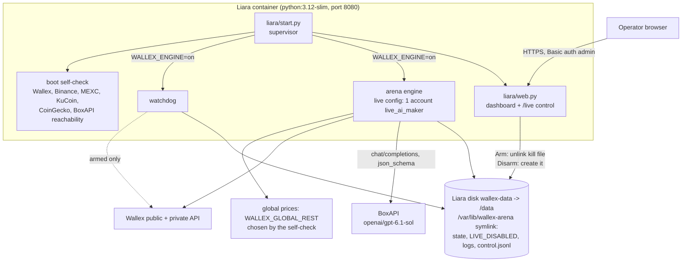
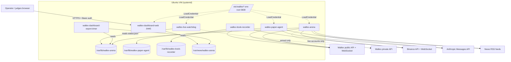
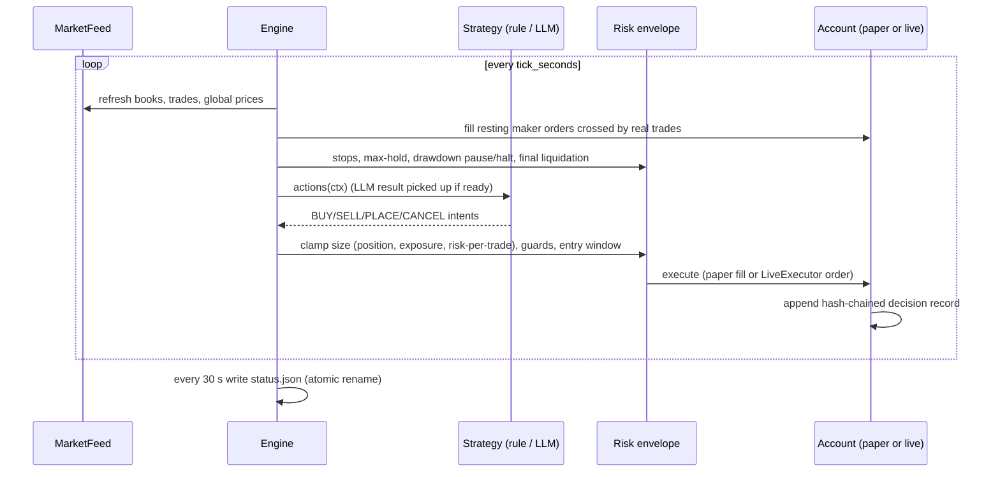

# Architecture

This document describes how the Wallex trading engine is put together: processes, data flow, state, and the
boundaries that keep real money safe. Strategy logic is documented in [components/arena.md](components/arena.md).

## 0. Production: Liara app `meowmeow-wallex`

- **Image**: root `Dockerfile` → `deploy/liara-wallex/deploy_liara.py assemble` lays out `/app` with
  `experiments/wallex_arena`, `experiments/wallex_agent/news.py` (used by the engine's `NewsFeed`), `liara/start.py`,
  `liara/web.py`, a generated `liara/live-config.template.json`, and the arena tests as `checks/` (run during the build).
  An optional results snapshot (`snapshot/`, made by `make_snapshot.py` on the paper-arena host) feeds the `/`,
  `/report`, `/decisions?src=snapshot` and `/paper-agent` pages.
- **Boot** (`start.py`): link `/var/lib/wallex-arena` to `/data/wallex-arena` (or `/tmp` without a disk); recreate the
  kill file unless `WALLEX_LIVE_ENABLED=1`; write the Wallex key from env to `/run/wallex/wallex.env` (0600); render the
  live config with `WALLEX_MODEL`; run the self-check; start engine + watchdog under a restart-every-20-s supervisor only
  when `WALLEX_ENGINE=on`; serve the dashboard.
- **Armed** = `WALLEX_ENGINE=on` ∧ `WALLEX_LIVE_ENABLED=1` ∧ `WALLEX_API_KEY` set ∧ no kill file. The `/live` page arms
  (password + phrase `ARM LIVE TRADING`) and disarms (one click); both are audited in `control.jsonl`.
- **LLM**: BoxAPI only. `BoxAPIClient` rotates keys round-robin, fails over on 401/402/403/408/409/429/5xx and
  network errors, cools a failed key down for 60 s, and never logs keys. Decisions use strict JSON-schema output.
- **Global prices**: Binance is blocked from Liara; the self-check sets `WALLEX_GLOBAL_REST` to the first reachable
  Binance-compatible API (Binance, then MEXC). KuCoin/CoinGecko are reachable but have no adapter (see
  [DEPLOYMENT.md §A9](DEPLOYMENT.md#a9-price-feed-limitation-on-liara)).

The sections below describe the engine itself and the optional self-hosted deployment.

## 1. System context (self-hosted, optional)

All components are independent processes. They share nothing except files: the arena writes its state directory,
and the watchdog and dashboard exporter only read it. A crash in one never stops another; the watchdog exists
precisely because the arena can die.

## 2. The arena engine (`experiments/wallex_arena`)

| Module | Responsibility |
|---|---|
| `__main__.py` | CLI: `run CONFIG ROOT KEYFILE`, `status ROOT`, `report ROOT [OUT.md]` |
| `engine.py` | Tick loop, per-account risk envelope (`Risk`), order book-keeping, status/leaderboard, final liquidation |
| `feed.py`, `ws_feed.py`, `binance_ws.py` | `MarketFeed`: Wallex depth/trades (WebSocket with REST snapshots every N ticks), global quotes from `WALLEX_GLOBAL_REST` (Binance-compatible; Binance WebSocket only when the source is Binance), USDT/TMN, fair value, 1-min bars, market metadata |
| `strategies.py` | Rule strategies: `LagReversion`, `FairValueMaker`, `HoldBenchmark` |
| `ai.py`, `ai_strategy.py` | LLM decision loop in a background thread, JSON dashboard prompt, pydantic `Decision` schema, cost ledger with daily cap; `AITrader`, `AIMaker`. `openai/...` models go to BoxAPI, `claude-*` to the Anthropic SDK (optional import) |
| `boxapi.py` | `BoxAPIClient`: OpenAI-compatible chat completions with key rotation, fail-over, cooldown, redaction; `strict_schema()` |
| `account.py` | `PaperAccount` (SQLite fills/equity/positions, fee model, depth-walk fills) and `DecisionLog` (hash chain) |
| `live.py` | `WallexPrivateAPI` (REST client, redacted) and `LiveExecutor` (safety checks, bounded LIMIT orders, reconciliation) |
| `live_account.py` | `LiveAccount`: paper-account interface backed by `LiveExecutor` |
| `watchdog.py` | Dead-man switch: emergency `STOP_MARKET` orders when the engine is silent |
| `arena-config.json`, `excluded_markets.json` | Accounts/strategies/risk overrides; organizer-excluded markets |

### Tick

LLM calls never block the tick: `ai.py` runs them in a background thread at the configured interval and the engine
picks up the validated `Decision` on a later tick. If the model is slow, over budget or returns invalid JSON, the
account simply has no new discretionary actions; protective exits still run.

### Paper vs live accounts

An account is created as `PaperAccount` unless its config entry has `"live"`:

- `"live": "dry_run"` — `LiveExecutor` with a key-less client: builds and logs the exact Wallex request, never sends.
  The shipped config has one such account (`live_dry_maker`) to exercise the live code path.
- `"live": true` — real client from `wallex_env_file`. Every order still passes `LiveExecutor.enabled()` / `_gate()` and the market/notional checks:
  kill file absent, `WALLEX_LIVE_ENABLED == "1"`, configured client, eligible TMN market, notional between
  100,000 TMN (or market minimum) and `max_order_tmn`.

## 3. The paper research agent (`experiments/wallex_agent`)

A separate long-running process with **no order transport**. Every 300 s it ranks 16 TMN markets using frozen
XGBoost + Ridge forecasts (`artifacts/wallex_agent/quant-universe-v2/model.json`, tree files verified by SHA-256),
collects point-in-time news, asks three Claude Haiku specialists (crypto, macro/geopolitics, skeptical risk), applies
an independent risk gate and simulates fills on a shared 5,000,000 TMN SQLite portfolio. A protective monitor thread
checks held positions every 30 s with fresh public depth and no LLM calls. Details:
[components/paper-agent.md](components/paper-agent.md), [components/market-data.md](components/market-data.md).

## 4. Supporting services (`services/`)

| Script | Input | Output |
|---|---|---|
| `book_recorder.py DB [PERIOD]` | Wallex `/v1/markets`, `/v1/depth`, `/v1/trades`; Binance `bookTicker` | SQLite tables `book`, `trades`, `binance`, `errors` (WAL) |
| `dashboard_export.py OUT [STATE]` | `STATE/status.json`, `STATE/accounts/*/account.sqlite` | `leaderboard.json`, `equity.json`, `trades.json`, `health.json` |
| `dashboard_server.py PORT DIR` | `DIR/index.html`, `DIR/data/*.json`; credentials `tls_cert`, `tls_key`, `password` | HTTPS (TLS ≥ 1.2), Basic auth (user `meowmeow`), no directory listing, `Cache-Control: no-store` |

All three use only the Python standard library.

## 5. State and data

| Path | Owner | Contents | Backup? |
|---|---|---|---|
| `/var/lib/wallex-arena/status.json` | arena | Leaderboard, stream health, USDT/TMN, guards (rewritten every 30 s) | no (derived) |
| `/var/lib/wallex-arena/accounts/<name>/` | arena | `decisions.jsonl` (hash chain), `account.sqlite`, `orders.json`, `state.json`, `llm-budget.sqlite`, `live.jsonl`, `live_orders.json` | **yes** (audit evidence) |
| `/var/lib/wallex-arena/engine.jsonl`, `news.sqlite` | arena | Engine log, collected news | yes |
| `/var/lib/wallex-arena/watchdog.json`, `watchdog.jsonl` | watchdog | Emergency state, hash-chained watchdog log | yes |
| `/var/lib/wallex-arena/LIVE_DISABLED` | operator | Kill switch (presence = no live orders) | — |
| `/var/lib/wallex-paper-agent/` | paper agent | `paper-portfolio.sqlite`, `status.json`, `daemon.json`, `protection.json`, `news.sqlite`, `council-cache.sqlite`, `llm-budget.sqlite`, `artifacts/` | **yes** |
| `/var/lib/wallex-book-recorder/books.sqlite` | recorder | Raw market data (grows ~continuously) | optional |
| `/var/www/wallex-arena/` | installer / exporter | `index.html` + exported JSON | no |

## 6. Trust boundaries

1. **Secrets** — Liara: app env vars (the Wallex key is copied to a 0600 file under `/run/wallex`); self-hosted:
   systemd `LoadCredential=` (read-only tmpfs under `/run/credentials/<unit>/`). Never in the repository or logs.
2. **LLM output** is untrusted: schema-validated, values clamped, and executed only through the same risk envelope as
   rule strategies. News text is labelled untrusted in prompts.
3. **Live orders** require config (`"live": true`) + environment (`WALLEX_LIVE_ENABLED=1`) + filesystem
   (no `LIVE_DISABLED`) + a key file. Each layer is controlled separately.
4. **Dashboards** — Liara `web.py`: Basic auth on every page but `/healthz`, POSTs need `X-Requested-With`, arming needs
   the password + typed phrase; self-hosted: read-only static content behind TLS and Basic auth (`DynamicUser`).

## 7. Legacy code

`agents/ bot/ core/ data/ features/ memory/ ml/ tools/ utils/ main.py settings.py` are the pre-hackathon
"CryptoAlpha" signal framework (Telegram bot, ensemble models on Binance data). The Wallex services do not import
it except `tests/test_exchange.py`, which covers `data/`. It is kept for reference and reuse.
