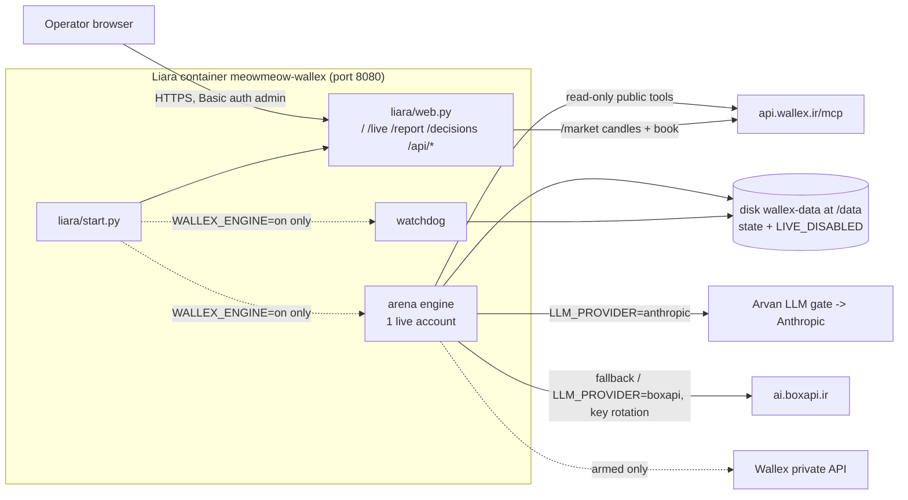

# Deployment

Production runs on **Liara** as the Docker app `meowmeow-wallex` (`https://meowmeow-wallex.liara.run`): a
password-protected dashboard plus a live-engine control page. The trading engine is **deployed idle and disarmed**:
it does nothing until an operator turns it on and arms it. The LLM provider is switchable with one variable,
`LLM_PROVIDER=anthropic|boxapi` (production: `anthropic`, i.e. `claude-sonnet-5-5` through the Arvan LLM gate, with
BoxAPI `openai/gpt-6.1-sol` as automatic fallback). Market data for the AI comes from the official **Wallex MCP**
server (see [How we use Wallex MCP/API](#how-we-use-wallex-mcpapi)).

The Ubuntu/systemd setup (paper arena, paper agent, recorder, self-hosted dashboard) is the
[optional self-hosted alternative](#part-b--self-hosted-ubuntu--systemd-optional).

**Part A — Liara (primary)**
- [A1. What gets deployed](#a1-what-gets-deployed)
- [A2. Prerequisites](#a2-prerequisites)
- [A3. Environment variables and disk](#a3-environment-variables-and-disk)
- [A4. First deploy](#a4-first-deploy)
- [A5. Arm and disarm (live trading)](#a5-arm-and-disarm-live-trading)
- [A6. Upgrades](#a6-upgrades)
- [A7. Rollback](#a7-rollback)
- [A8. Logs, metrics and health](#a8-logs-metrics-and-health)
- [A9. Price-feed limitation on Liara](#a9-price-feed-limitation-on-liara)
- [A10. Troubleshooting (Liara)](#a10-troubleshooting-liara)

**Part B — Self-hosted (Ubuntu + systemd, optional)**: sections [1](#1-targets-and-prerequisites)–[12](#12-uninstall).

## A1. What gets deployed



| Piece | Source in this repo | Notes |
|---|---|---|
| Image | `Dockerfile` (repo root) | Multi-stage; `deploy_liara.py assemble` lays out `/app` (arena package, `news.py`, `liara/start.py`, `liara/web.py`, generated `liara/live-config.template.json`, arena tests as `checks/`). The arena checks run during the build |
| Entrypoint | `deploy/liara-wallex/start.py` | Creates the kill file at every boot unless `WALLEX_LIVE_ENABLED=1`, runs connectivity self-checks, starts the engine + watchdog only if `WALLEX_ENGINE=on`, serves the dashboard |
| Dashboard | `deploy/liara-wallex/web.py` | `/` paper/shadow results snapshot (if bundled), `/live` engine control (ARM/DISARM), `/report`, `/decisions`, `/healthz` (no auth) |
| Live config | generated from `arena-config.json` at boot | One real account `live_ai_maker` (params of `ai_maker_sonnet`; model from `LLM_PROVIDER` + `WALLEX_ANTHROPIC_MODEL`/`WALLEX_BOXAPI_MODEL`; total exposure `WALLEX_MAX_EXPOSURE`, default 0.35; challenge end/flatten from `WALLEX_CHALLENGE_END_UTC`), `max_order_tmn` 2,000,000 |
| Results snapshot | optional `./snapshot/` | Built by `deploy/liara-wallex/make_snapshot.py` on the paper-arena host; data, never committed |
| Liara config | `liara.json` | app, `platform: docker`, port 8080, disk `wallex-data` → `/data`, build in Germany |

## A2. Prerequisites

- A Liara account and team with the app `meowmeow-wallex` (Docker platform) on a network-enabled plan.
- One of: the Liara CLI (`npm i -g @liara/cli`, then `liara login`), **or** the API helper `liara_cli.py` from the
  `liara-sre` repository (`tools/liara_cli.py`, also usable as `lia.py`) with `LIARA_API_TOKEN` and `LIARA_TEAM_ID`
  in the environment or `~/.liara.env` (mode 0600).
- BoxAPI keys (comma-separated) and, for live trading only, the Wallex **credit sub-account** API key and its id.
- For `make liara-deploy-api`: run on the build host that has the paper-arena state if you want the results snapshot
  (`make_snapshot.py` reads `/var/lib/wallex-arena` and `/var/lib/wallex-paper-agent`).

## A3. Environment variables and disk

Set in the Liara console (Settings → Environment variables), with `deploy_liara.py setenv`, or the API. Liara
replaces the **whole** env list on every update — `deploy_liara.py setenv` merges for you; the console does too.

| Variable | Required | Default | Description |
|---|---|---|---|
| `WALLEX_ADMIN_PASSWORD` | **yes** | — | Basic-auth password for user `admin`. Without it every page except `/healthz` is refused |
| `BOXAPI_KEYS` | for AI | — | Comma-separated BoxAPI keys; round-robin with fail-over on 401/402/403/408/409/429/5xx and a 60 s per-key cooldown |
| `BOXAPI_BASE_URL` | no | `https://ai.boxapi.ir/ai/v1` | OpenAI-compatible endpoint |
| `LLM_PROVIDER` | no | `anthropic` | `anthropic` or `boxapi`: primary provider for every AI call; the other one is the automatic fallback on 429/5xx/credit/auth/network errors (when it has credentials) |
| `ANTHROPIC_BASE_URL` | with `anthropic` | `https://api.anthropic.com` | On Liara: the Arvan LLM gate URL (`LLM_GATE_URL` from the team secrets file). Never an Anthropic key or relay token on Liara |
| `ANTHROPIC_AUTH_TOKEN` | with `anthropic` | — | Bearer token for the gate (`LLM_GATE_TOKEN`). A direct `ANTHROPIC_API_KEY` is also accepted elsewhere |
| `WALLEX_ANTHROPIC_MODEL` | no | `claude-sonnet-5-5` | Anthropic model (tier map: gpt-6.1-sol <-> claude-sonnet-5-5, gpt-6-luna <-> claude-haiku-5-5) |
| `WALLEX_BOXAPI_MODEL` | no | `openai/gpt-6.1-sol` | BoxAPI model |
| `LLM_FALLBACK` | no | `1` | `0` disables the cross-provider fallback |
| `WALLEX_MCP_TOOLS` | no | `0` (Liara: `1`) | `1` lets the AI call Wallex MCP market-data tools in a research step before each decision |
| `WALLEX_MCP_URL` | no | `https://api.wallex.ir/mcp` | Wallex MCP server (Streamable HTTP) |
| `WALLEX_MCP_MAX_CALLS` | no | `6` | Tool calls the AI may make per decision |
| `WALLEX_MAX_EXPOSURE` | no | `0.35` | Total maker inventory cap as a fraction of equity (recommended 0.30-0.40; paper-tested 0.45) |
| `WALLEX_CHALLENGE_END_UTC` | **set it** | `2026-10-23T20:00:00Z` (placeholder) | Official end of trading. Only realized TMN counts: the engine flattens everything to TMN before it |
| `WALLEX_FLATTEN_MINUTES` | no | `60` | From this many minutes before the end: cancel all orders and sell every coin to TMN (retried each 30 s per market until flat) |
| `WALLEX_NO_NEW_ENTRIES_MINUTES` | no | `120` | From this many minutes before the end: no new positions |
| `SNAPSHOT_PUSH_TOKEN` | for pushes | — | Bearer token for `POST /api/snapshot/push` (results pushed from the arena host every 5 min) |
| `OBS_ENV` | no | `dev` (Liara: `liara`) | `env` field of the JSON logs |
| `LOG_LEVEL` | no | `info` | `debug` adds successful external calls |
| `WALLEX_ENGINE` | no | `off` | `on` starts the engine + watchdog in the container; anything else = dashboard only |
| `WALLEX_LIVE_ENABLED` | no | `0` | Must be `1` to arm. When not `1`, the kill file is recreated at every boot |
| `WALLEX_API_KEY` | live only | — | Credit sub-account API key (written to `/run/wallex/wallex.env`, 0600, inside the container) |
| `WALLEX_SUBACCOUNT_ID` | live only | — | Sub-account `clientId`, sent as `sub-account-client-id` |
| `WALLEX_GLOBAL_REST` | no | auto | Binance-compatible REST base for global prices; auto-picked by the self-check (Binance, else MEXC). See [A9](#a9-price-feed-limitation-on-liara) |
| `WALLEX_SELFHOSTED_URL` | no | — | Optional extra URL for the connectivity self-check |
| `TZ` | no | `UTC` | Set by the deploy script |
| `PORT` | no | `8080` | Listening port (matches `liara.json`) |

**Disk:** `wallex-data` (1 GB) mounted at `/data`. It holds the engine state (`/data/wallex-arena`, `WALLEX_STATE_DIR`), including the kill file `LIVE_DISABLED`, decision logs and the control audit
`control.jsonl`. Without the disk the state is ephemeral (`/tmp`) and the log says so. `deploy_liara.py deploy` creates
the disk if missing; with the CLI create it first (console → Disks, or `POST /v1/projects/meowmeow-wallex/disks
{"name":"wallex-data","size":1}`), otherwise the release fails with `disk_not_found`.

## A4. First deploy

Three equivalent ways; all ship code only and start the engine **OFF, DISARMED**.

**a) Liara CLI from the repository root** (uses `liara.json`, `.liaraignore`, root `Dockerfile`; keeps existing envs):

```bash
make liara-deploy            # = liara deploy --app meowmeow-wallex
```

Then set the variables of A3 in the console (at least `WALLEX_ADMIN_PASSWORD`, `BOXAPI_KEYS`, `WALLEX_ENGINE=off`,
`WALLEX_LIVE_ENABLED=0`).

**b) Deploy script through the API** (adds the paper/shadow results snapshot; sets the safe default envs):

```bash
# build host, repository checkout, root; needs /root/.boxapi.env (BOXAPI_KEYS, BOXAPI_BASE_URL) and the Liara helper
make liara-deploy-api        # = deploy_liara.py build && deploy_liara.py deploy
```

`deploy` creates the disk if needed, uploads the build directory (`$WALLEX_LIARA_BUILD`, default
`/opt/wallex/liara-build`) as a Docker source, and releases it with `WALLEX_ENGINE=off`,
`WALLEX_LIVE_ENABLED=0`, `LLM_PROVIDER=anthropic`, `ANTHROPIC_BASE_URL`/`ANTHROPIC_AUTH_TOKEN` (from `LLM_GATE_URL`/`LLM_GATE_TOKEN`),
`WALLEX_ANTHROPIC_MODEL`, `WALLEX_BOXAPI_MODEL`, `BOXAPI_*` and a generated admin password (stored in
`$WALLEX_ADMIN_ENV_FILE`, default `/root/.wallex-liara-admin.env`, mode 0600). **Note:** a release body's `envs`
replaces all envs, so a script deploy resets the app to the disarmed defaults (any `WALLEX_API_KEY` must be set again).

**c) Raw API** (what the script does): `POST /v2/projects/meowmeow-wallex/sources` (multipart `file`, gzip tar) →
`sourceID`; `POST /v2/projects/meowmeow-wallex/releases {sourceID, type:"docker", port:8080, disks:[{name:"wallex-data",
mountTo:"/data"}], build:{location:"germany"}, envs:{...}}`; poll `GET /v1/projects/meowmeow-wallex/releases?page=1&count=1`
until `READY`.

Verify:

```bash
curl -s https://meowmeow-wallex.liara.run/healthz                       # ok
curl -s -u admin:'<password>' https://meowmeow-wallex.liara.run/api/live | python3 -m json.tool | head -30
# expect state.armed=false, kill_file_present=true, engine_enabled=false; selfcheck shows reachability
```

## A5. Arm and disarm (live trading)

Arming needs **all** of: `WALLEX_ENGINE=on`, `WALLEX_LIVE_ENABLED=1`, `WALLEX_API_KEY` set (plus
`WALLEX_SUBACCOUNT_ID`), **and** the kill file removed from the `/live` page with the admin password and the typed phrase
`ARM LIVE TRADING`. Every arm/disarm attempt is appended to `/data/wallex-arena/control.jsonl`.

Before arming, complete the [go-live checklist](#5-go-live-checklist-real-orders) items 1–3 (shadow results reviewed,
organizer rules confirmed, sub-account key) and check the [price feed](#a9-price-feed-limitation-on-liara).

```bash
# 1. Put the key into the app without leaving it in shell history (or use the Liara console instead)
read -rs WK; read -r SUB
python3 deploy/liara-wallex/deploy_liara.py setenv "WALLEX_API_KEY=$WK" "WALLEX_SUBACCOUNT_ID=$SUB"
unset WK
# 2. Turn the engine on and allow live mode (app restarts; it is still DISARMED because the kill file persists on /data)
python3 deploy/liara-wallex/deploy_liara.py setenv WALLEX_ENGINE=on WALLEX_LIVE_ENABLED=1
```

3. Open `https://meowmeow-wallex.liara.run/live`: check the engine process is running, the self-check is green,
   **Balances** shows the credit sub-account, and the AI self-test succeeds.
4. Type the admin password and `ARM LIVE TRADING`, press **Arm**. State turns `ARMED`.
5. Watch `/live` (equity, positions, decisions, errors) and the Wallex UI for the first fills.

**Disarm (kill switch), fastest first:**

| Method | Effect | Time |
|---|---|---|
| `/live` → **Disarm** (one click, no password) | Creates `LIVE_DISABLED`; the next order call is refused | immediate |
| `deploy_liara.py setenv WALLEX_LIVE_ENABLED=0` | Restart; kill file recreated at boot; client gate closed | ~30 s |
| `deploy_liara.py setenv WALLEX_ENGINE=off` | Restart without engine and watchdog | ~30 s |
| Liara console → app off (`POST /v1/projects/meowmeow-wallex/actions/scale {"scale":0}`) | Everything stops; open orders/positions stay on Wallex | ~10 s |

While the kill file exists the client also refuses `cancel()`; flatten positions in the Wallex UI if needed. With the
engine stopped (`WALLEX_ENGINE=off` or app off) the watchdog is stopped too, so no exchange-side stops are placed.

## A6. Upgrades

```bash
git pull && make test                     # locally or in CI
make liara-deploy                         # CLI: code only, envs and disk state kept
# or: make liara-deploy-api               # API + fresh snapshot (resets envs to disarmed defaults)
make liara-releases                       # confirm the new release is READY and current
```

State on `/data` survives deploys. If the app was armed, a CLI deploy keeps `WALLEX_LIVE_ENABLED=1` and the kill-file
state; disarm first unless you intend to trade through the restart (the engine restarts in well under the
watchdog's 120 s threshold, but the watchdog restarts with it).

## A7. Rollback

Liara keeps earlier releases. Roll back to the previous READY release:

```bash
make liara-releases                                   # id, tag, state, type, date; marks the current one
make liara-rollback RELEASE=<release _id>             # POST /v1/releases/{id}/rollback
```

Raw API: `GET /v1/projects/meowmeow-wallex/releases?page=1&count=20` → pick the newest release with
`state=READY`, `type` DEPLOY or ENV_UPDATE and `_id != currentRelease` → `POST /v1/releases/{_id}/rollback` (no body).
Errors: 409 already current, 404 not rollback-able, 428 `rollback_not_supported`. Fallback: redeploy the previous git
tag (`git checkout <tag> && make liara-deploy`). A rollback restores that release's image (and, as far as
observed, creates a new release record; verify the env list afterwards); the `/data` disk (state, kill file) is not
rolled back. In an incident, **disarm first**.

## A8. Logs, metrics and health

| What | How |
|---|---|
| Liveness | `GET /healthz` (no auth) → `ok` |
| Engine/arm state, self-check, positions, errors | `/live` page or `GET /api/live` (auth) |
| Runtime logs | `make liara-logs` (CLI) or `GET /v2/projects/meowmeow-wallex/logs?start=<unix s>` on `https://api.iran.liara.ir` (`?teamID=<LIARA_TEAM_ID>`); lines tagged `[start]`, `[web]`, engine output |
| Build logs | `GET /v2/releases/{releaseID}/build-logs` |
| Container events (OOM, die, restart) | `GET /v1/projects/meowmeow-wallex/events?start=<unix s>&end=<unix s>` |
| Metrics | `GET /v1/projects/meowmeow-wallex/metrics/summary`; `GET .../metrics/{cpu,memory}?since=<unix seconds>` |
| Disk usage / backups | `GET /v1/projects/<id>/disks/wallex-data/metrics`; disk backups via console or `POST /v1/projects/<id>/disks/wallex-data/backups` |
| Control audit | `/data/wallex-arena/control.jsonl` (arm/disarm/balances/self-test records) |

Log retention follows the bundle (Bronze 7, Silver 30, Gold 60 days); copy audit logs off the disk at the end of a run.

## A9. Price-feed limitation on Liara

The lag and fair-value logic needs global prices. From Liara's (Iran-hosted) runtime, **Binance is blocked**, while
**KuCoin and CoinGecko are reachable**. The code reads global prices from a **Binance-compatible** REST API set by
`WALLEX_GLOBAL_REST`; the boot self-check picks Binance if reachable, else MEXC (Binance-compatible), and records the
choice as `selfcheck.global_source` in `/api/live`. The Binance WebSocket stream is only used when the source is Binance.
KuCoin and CoinGecko have **no adapter yet**, so if neither Binance nor MEXC is reachable `global_source` is `null`
and the engine falls back to Binance and gets no global prices — keep the engine **off** in that case. Wallex market
data itself (REST + WebSocket) is reachable from Liara.

## A10. Troubleshooting (Liara)

| Symptom | Cause | Fix |
|---|---|---|
| Every page 401/refused | `WALLEX_ADMIN_PASSWORD` missing or wrong | Set it (`setenv`); user is `admin` |
| Release `FAILED disk_not_found` | Disk `wallex-data` missing | Create the disk (A3), redeploy |
| Release fails in `pytest checks` | A code change broke an arena test | Run `make test-arena` locally; fix before deploying |
| `/api/live` `engine_process` restarting every 20 s | Engine crash on start (see logs) | Check logs; set `WALLEX_ENGINE=off` until fixed |
| Arm refused (409) | Missing env, wrong password or phrase | The response lists each missing condition |
| AI self-test 502 / `boxapi:` errors | Keys invalid/exhausted or BoxAPI unreachable | Check `boxapi_models` in the self-check; rotate `BOXAPI_KEYS` |
| `global_source: null` | Binance and MEXC unreachable | See A9; keep engine off |
| State "EPHEMERAL (no /data disk)" in logs | Disk not mounted | Add the disk mount (liara.json / release `disks`) |
| `liara deploy` refuses: "app isn't running" | App scaled to 0 | Start it in the console or `actions/scale {"scale":1}` |

---

# Part B — Self-hosted (Ubuntu + systemd, optional)

Runs the full paper arena, the paper research agent, the book recorder and a self-hosted dashboard as hardened systemd
units. Use it for long paper/shadow runs and research; production trading uses Part A. Note: the shipped
`arena-config.json` still contains `claude-*` AI accounts (Anthropic key file); switch their `model` to
`openai/gpt-6.1-sol` and give the arena the BoxAPI variables to run them on BoxAPI instead:

```bash
sudo install -m 0600 /dev/null /etc/wallex/boxapi.env && sudoedit /etc/wallex/boxapi.env   # BOXAPI_KEYS=..., BOXAPI_BASE_URL=...
sudo mkdir -p /etc/systemd/system/wallex-arena.service.d
printf '[Service]\nEnvironmentFile=/etc/wallex/boxapi.env\n' | sudo tee /etc/systemd/system/wallex-arena.service.d/boxapi.conf
sudo systemctl daemon-reload && sudo systemctl restart wallex-arena
```

## 1. Targets and prerequisites

| Item | Requirement |
|---|---|
| OS | Ubuntu 22.04/24.04 (any systemd ≥ 250 distro works; credentials need `LoadCredential=`) |
| Python | 3.12+ with `venv` (`sudo apt install python3 python3-venv`); production runs 3.14.4 |
| CPU / RAM | 2 vCPU / 4 GB for arena + paper agent (units cap each at 1.5 GB) |
| Disk | ~1 GB for venv; state grows slowly; the book recorder grows ~continuously (plan GBs) |
| Egress | HTTPS to `api.wallex.ir` (REST + WebSocket), `api.binance.com` / Binance streams, `api.anthropic.com`, the RSS feeds in `experiments/wallex_agent/news.py` and `experiments/wallex_arena/engine.py` |
| Ingress | none required; optional dashboard port (default 9445/tcp) |
| Clock | NTP-synchronised (`timedatectl`); the final liquidation time is absolute UTC |

Layout used in this guide (all overridable in `deploy/systemd/install.sh`):

| Variable | Default | Meaning |
|---|---|---|
| `APP_DIR` | repo checkout | Use `/opt/wallex-trading` (must not be under `/home` or `/root`: units use `ProtectHome=yes`) |
| `VENV` | `$APP_DIR/.venv` | Python virtualenv |
| `SERVICE_USER` | `wallex` | Unprivileged system user (created if missing) |
| `SECRETS_DIR` | `/etc/wallex` | Root-owned 0700 directory with secret files |
| `ARENA_CONFIG` | `$APP_DIR/experiments/wallex_arena/arena-config.json` | Arena accounts/risk config |
| `WEB_DIR` / `DASHBOARD_PORT` | `/var/www/wallex-arena` / `9445` | Dashboard static root / port |
| `TLS_CERT` / `TLS_KEY` | `/etc/letsencrypt/live/<DASHBOARD_HOST>/...` | Dashboard certificate |

## 2. First-time install (paper mode)

```bash
# 2.1 Code and virtualenv
sudo apt-get update && sudo apt-get install -y git python3 python3-venv make
sudo git clone <REPO_URL> /opt/wallex-trading
cd /opt/wallex-trading
sudo git checkout <RELEASE_TAG>          # e.g. v1.0.0
sudo make venv                            # .venv with pinned runtime deps

# 2.2 (recommended) prove the checkout on this host
sudo make install-dev && sudo make test   # expect: 422 passed, 3 skipped

# 2.3 Secrets (see section 3), then render + install units (enables nothing yet)
sudo install -d -m 0700 -o root -g root /etc/wallex
sudo install -m 0600 -o root -g root deploy/env/anthropic.env.example /etc/wallex/anthropic.env
sudoedit /etc/wallex/anthropic.env        # paste the real key
make systemd-render                       # optional: review build/systemd/*.service first
sudo deploy/systemd/install.sh install

# 2.4 Check the arena config before starting (end time, accounts, no "live": true)
grep -n '"liquidate_at_utc"\|"live"' experiments/wallex_arena/arena-config.json

# 2.5 Start paper services
sudo systemctl enable --now wallex-arena wallex-paper-agent
sleep 60 && make arena-status STATE=/var/lib/wallex-arena   # run as root or the service user
```

The arena and paper agent create their state directories (`StateDirectory=`) on first start. Nothing here can send
an order: the units do not set `WALLEX_LIVE_ENABLED`, and the shipped config has only a `dry_run` live account.

## 3. Secrets

| File (root:root 0600) | Contents | Needed by |
|---|---|---|
| `/etc/wallex/anthropic.env` | `ANTHROPIC_API_KEY=sk-ant-...` | `wallex-arena` (AI accounts), `wallex-paper-agent` |
| `/etc/wallex/wallex.env` | `WALLEX_API_KEY=...`, `WALLEX_SUBACCOUNT_ID=...` | `wallex-live-watchdog`, live arena accounts |
| `/etc/wallex/dashboard-password.txt` | one line, the Basic-auth password for user `meowmeow` | `wallex-dashboard-web` |

Templates: `deploy/env/*.example`. systemd copies each file into `/run/credentials/<unit>/` for the service only;
nothing is exported into the environment. Rotate a key by editing the file and `sudo systemctl restart <unit>`.
Never paste keys into commands that end up in shell history, tickets or chat.

## 4. Optional: dashboard and book recorder

```bash
# TLS certificate for the dashboard host (any valid cert/key pair works)
sudo apt-get install -y certbot && sudo certbot certonly --standalone -d <DASHBOARD_HOST>
# Password file
sudo sh -c 'umask 077; openssl rand -base64 24 > /etc/wallex/dashboard-password.txt'
# Re-render units with the cert paths, then enable
sudo TLS_CERT=/etc/letsencrypt/live/<DASHBOARD_HOST>/fullchain.pem \
     TLS_KEY=/etc/letsencrypt/live/<DASHBOARD_HOST>/privkey.pem \
     deploy/systemd/install.sh install
sudo systemctl enable --now wallex-dashboard-export.timer wallex-dashboard-web
sudo ufw allow 9445/tcp    # if ufw is active
curl -sk -u meowmeow:"$(sudo cat /etc/wallex/dashboard-password.txt)" https://localhost:9445/data/health.json

# Public order-book recorder (no credentials)
sudo systemctl enable --now wallex-book-recorder
```

Behind an existing nginx instead of exposing 9445: proxy a location to `https://127.0.0.1:9445/` with
`proxy_ssl_verify off`, or serve `/var/www/wallex-arena` directly with nginx `auth_basic`.

## 5. Go-live checklist (real orders)

Do not skip steps. One person executes, a second person confirms each box.

1. [ ] Paper/shadow run of the exact release has been running ≥ 24 h; `make arena-report` reviewed; no unexplained
       errors in `journalctl -u wallex-arena`.
2. [ ] Organizer rules confirmed: approved markets (update `excluded_markets.json`), trading cutoff
       (`liquidate_at_utc`), minimum order, fee tier.
3. [ ] `/etc/wallex/wallex.env` contains the **credit sub-account's own** API key and its `WALLEX_SUBACCOUNT_ID`.
4. [ ] Read-only wiring check (no orders):
       ```bash
       cd /opt/wallex-trading && sudo .venv/bin/python - <<'PY'
       from experiments.wallex_arena.live import WallexPrivateAPI
       api = WallexPrivateAPI.from_env_file("/etc/wallex/wallex.env")
       print(sorted((api.balances_detail() or {}).keys()))   # must be the sub-account's assets
       print(api.account_fee() is not None)
       PY
       ```
5. [ ] Kill switch armed first: `sudo touch /var/lib/wallex-arena/LIVE_DISABLED`.
6. [ ] In the arena config, set exactly the intended account(s) to `"live": true` with a conservative
       `"max_order_tmn"`, and set `"wallex_env_file": "/run/credentials/wallex-arena.service/wallex"`.
7. [ ] Install the drop-ins and restart:
       ```bash
       cd /opt/wallex-trading && make systemd-render
       sudo install -D -m 0644 build/systemd/live/wallex-arena.live.conf /etc/systemd/system/wallex-arena.service.d/live.conf
       sudo install -D -m 0644 build/systemd/live/wallex-live-watchdog.live.conf /etc/systemd/system/wallex-live-watchdog.service.d/live.conf
       sudo systemctl daemon-reload
       sudo systemctl restart wallex-arena && sudo systemctl enable --now wallex-live-watchdog
       systemctl show wallex-arena -p Environment     # must contain WALLEX_LIVE_ENABLED=1
       ```
8. [ ] Engine healthy (section 9) with the kill switch still present: live accounts log `LiveRefused` instead of orders.
9. [ ] **Go:** `sudo rm /var/lib/wallex-arena/LIVE_DISABLED`. Watch `tail -f /var/lib/wallex-arena/accounts/<live>/live.jsonl`
       and the Wallex UI for the first fills; compare fees with the model.
10. [ ] Stop at any doubt: `sudo touch /var/lib/wallex-arena/LIVE_DISABLED`.

Going back to paper: create the kill file, remove both `live.conf` drop-ins, `daemon-reload`, restart
`wallex-arena`, `systemctl disable --now wallex-live-watchdog`, then flatten positions in the Wallex UI if needed.

## 6. Upgrades

```bash
cd /opt/wallex-trading
sudo scripts/backup_state.sh                      # 1. backup (section 8)
sudo git fetch --tags && sudo git checkout <NEW_TAG>
sudo make venv                                    # 2. deps (no-op if unchanged)
sudo make install-dev && sudo make test           # 3. optional but recommended
sudo deploy/systemd/install.sh install            # 4. re-render units (keeps live drop-ins in *.d/)
sudo systemctl restart wallex-arena wallex-paper-agent   # 5. restart what runs
make status                                       # 6. verify (section 9)
```

State survives restarts: accounts, resting orders (`orders.json`), pause/halt flags and the LLM budget are reloaded.
If accounts are live, keep `wallex-live-watchdog` running during the restart; restarts shorter than 120 s do not
trigger it. Changing `arena-config.json` account names creates new accounts (old directories stay on disk).

## 7. Rollback

There is no migration step, so rollback is a code checkout:

```bash
cd /opt/wallex-trading
git describe --tags                       # note the current version
sudo git checkout <PREVIOUS_TAG>
sudo make venv && sudo deploy/systemd/install.sh install
sudo systemctl restart wallex-arena wallex-paper-agent
```

If a release corrupted state, stop the unit, restore the last good backup (section 8) and start it again.
In a live incident, create the kill file **before** anything else.

## 8. Backups and restore

```bash
sudo scripts/backup_state.sh                       # -> /var/backups/wallex/<UTC timestamp>/, keeps 14
echo '0 * * * * root /opt/wallex-trading/scripts/backup_state.sh >/dev/null' | sudo tee /etc/cron.d/wallex-backup
```

The script uses SQLite's online-backup API (consistent while services run) and tars the JSON/JSONL files. The
hash-chained `decisions.jsonl` logs are the audit evidence for judges — copy backups off the host as well.

Restore one service:

```bash
B=/var/backups/wallex/<TIMESTAMP>
sudo systemctl stop wallex-arena
sudo tar -C /var/lib -xzf $B/wallex-arena/files.tar.gz
sudo cp -a $B/wallex-arena/sqlite/. /var/lib/wallex-arena/
sudo chown -R wallex:wallex /var/lib/wallex-arena
sudo systemctl start wallex-arena
sudo .venv/bin/python -c "from experiments.wallex_arena.account import DecisionLog; import sys; print(DecisionLog.verify(sys.argv[1]))" /var/lib/wallex-arena/accounts/<name>/decisions.jsonl
```

## 9. Health checks

| Check | Command | Healthy |
|---|---|---|
| Units | `make status` | arena, paper-agent active; timers listed |
| Arena heartbeat | `sudo python3 -c "import json,time;print(time.time()-json.load(open('/var/lib/wallex-arena/status.json'))['updated_at'])"` | < 60 s (written every 30 s) |
| Leaderboard | `sudo -u wallex .venv/bin/python -m experiments.wallex_arena status /var/lib/wallex-arena` | recent update, no unexpected `HALTED` |
| Stream health | `sudo jq '.stream, .global_stream, .usdt_tmn_halted' /var/lib/wallex-arena/status.json` | connected, `usdt_tmn_halted: false` |
| Paper agent | `sudo -u wallex .venv/bin/python -m experiments.wallex_agent status --state /var/lib/wallex-paper-agent`; `sudo jq . /var/lib/wallex-paper-agent/daemon.json` | `consecutive_errors` 0, recent `last_completed_at` |
| Watchdog (live) | `sudo jq . /var/lib/wallex-arena/watchdog.json` | `"emergency": false` |
| Kill switch | `ls -l /var/lib/wallex-arena/LIVE_DISABLED` | present unless intentionally live |
| Dashboard | `curl -sk -o /dev/null -w '%{http_code}' https://localhost:9445/` | `401` without auth, `200` with |
| Audit chain | `DecisionLog.verify(...)` (section 8) | returns the record count, no exception |

## 10. Logs

```bash
journalctl -u wallex-arena -f                    # engine (stdout/stderr)
journalctl -u 'wallex-*' --since '1 hour ago'    # everything
tail -f /var/lib/wallex-arena/engine.jsonl       # engine events
tail -f /var/lib/wallex-arena/accounts/<name>/decisions.jsonl   # per-account decisions (hash-chained)
tail -f /var/lib/wallex-arena/accounts/<name>/live.jsonl        # live/dry-run requests (key redacted)
journalctl -u wallex-paper-agent -o cat | grep paper_cycle      # agent cycles (JSON lines)
```

The dashboard server intentionally writes no access log.

## 11. Troubleshooting

| Symptom | Likely cause | Fix |
|---|---|---|
| Unit fails with `status=243/CREDENTIALS` | Secret file missing or unreadable | Create `/etc/wallex/<file>` (root, 0600); `systemctl restart` |
| `status=200/CHDIR` or `No such file` for the venv | `APP_DIR` under `/home` (ProtectHome) or venv missing | Use `/opt/wallex-trading`; `sudo make venv`; re-run `install.sh install` |
| AI accounts never act, `ai_decision` records with `ok: false` | Anthropic key invalid, egress blocked, or daily USD cap reached | Check `journalctl`; `llm-budget.sqlite` per account; verify egress to `api.anthropic.com` |
| Paper agent `secret_preflight_error` / `insecure_secret_permissions` | Key file not 0600 or wrong format (`sk-ant-...`) | `chmod 600`; key line `ANTHROPIC_API_KEY=sk-ant-...` |
| `status.json` stale, unit active | Feed stuck on network errors | `jq .feed_errors_recent status.json`; check egress to Wallex/Binance; restart |
| All accounts paused / `HALTED` | Drawdown pause (5 %) or halt (10 %) hit | Expected protection; halts persist in `accounts/<name>/state.json` by design |
| Live account logs `LiveRefused` | Kill file present or `WALLEX_LIVE_ENABLED` not `1` | Intended unless going live (section 5) |
| `AmbiguousOrder` in `live.jsonl` | Timeout on order POST | No resubmission by design; `sync()` resolves it; confirm in the Wallex UI |
| Watchdog placed stops (`watchdog_take_over`) | Arena silent > 120 s | Fix/restart the arena; watchdog stands down and cancels its stops automatically |
| Dashboard 401 in browser | Wrong password | User is `meowmeow`; password in `/etc/wallex/dashboard-password.txt` |
| Dashboard data stale | Timer not enabled or exporter cannot read state | `systemctl list-timers wallex-dashboard-export.timer`; `journalctl -u wallex-dashboard-export` |
| `pip install` fails (filtered network / mirror) | No PyPI access on the host | On a machine with access: `pip download -r requirements.txt -d wheels --python-version 3.12 --only-binary=:all:`; copy; `.venv/bin/pip install --no-index --find-links wheels -r requirements.txt` |
| Tests slow (minutes) | XGBoost training tests on a busy CPU | `OMP_NUM_THREADS=2 make test` (the Makefile already sets this) |

## 12. Uninstall

```bash
sudo touch /var/lib/wallex-arena/LIVE_DISABLED
sudo systemctl disable --now wallex-arena wallex-paper-agent wallex-live-watchdog wallex-book-recorder \
     wallex-dashboard-web wallex-dashboard-export.timer
sudo rm -f /etc/systemd/system/wallex-*.service /etc/systemd/system/wallex-*.timer
sudo rm -rf /etc/systemd/system/wallex-*.service.d && sudo systemctl daemon-reload
# Keep /var/lib/wallex-* and backups until the audit logs are archived.
```

## Keeping the results current (snapshot push)

The dashboard's paper/shadow results (home page charts, leaderboard, trades, report, decision tails, paper agent) are
**pushed** from the arena host. Liara cannot reach the Hetzner dashboard (port 9445), so there is no pull, and a push
needs no redeploy.

- **Hetzner side:** the systemd timer `wallex-liara-snapshot-push.timer` runs every 5 minutes. It starts
  `deploy/liara-wallex/push_snapshot.py`, which is **read-only** on the arena: it copies the 30-second dashboard
  export, `status.json`, the last 300 records of each decision log (AI input dashboards removed), the shadow-test
  report and the paper agent's status and newest decisions. It sends them as a ~1 MB gzip tar to
  `POST https://meowmeow-wallex.liara.run/api/snapshot/push` with `Authorization: Bearer $SNAPSHOT_PUSH_TOKEN` and
  `X-Snapshot-Sha256`, retrying up to 3 times.
- **Liara side:** the endpoint needs the token (env `SNAPSHOT_PUSH_TOKEN`; Basic auth is not used for it) and rejects:
  - bodies over 25 MB (`SNAPSHOT_PUSH_MAX_BYTES`);
  - unsafe tar members;
  - files missing from or not listed in `MANIFEST.json`, and any sha256 mismatch;
  - a snapshot that is not newer than the current one (409; versions come from the arena's own status timestamp).
- **Install and swap:** a valid snapshot is unpacked to `/data/snapshots/v<ts>`, and the symlink
  `/data/snapshots/current` is swapped atomically. The newest 3 versions are kept.
- **What the dashboard reads:** every file comes from the newest pushed snapshot, falling back to the snapshot bundled
  in the image. The home page re-fetches its chart data every 30 s. Every page shows
  «آخرین به‌روزرسانی: … (اختبار سایه/کاغذی)» in Tehran and UTC time, refreshed every 60 s from `GET /api/snapshot/info`.
- **Full logs:** the full hash-chained decision logs stay in the bundled snapshot (`/files/bundled/...`) and on the
  arena host.
- **Operate:**
  - Status: `systemctl status wallex-liara-snapshot-push.timer`.
  - Push now: `systemctl start wallex-liara-snapshot-push.service`.
  - Logs: `journalctl -u wallex-liara-snapshot-push`.
  - Stop: `systemctl disable --now wallex-liara-snapshot-push.timer`.
  - Unit files: `deploy/liara-wallex/wallex-liara-snapshot-push.{service,timer}`.
  - The token is stored in `/root/.wallex-liara-admin.env` (0600). `deploy_liara.py` creates it and sets it on Liara.

## How we use Wallex MCP/API

| Need | Source | Notes |
|---|---|---|
| Candles (OHLCV, 1/5/15/30/60/240 min, 1 day) | **Wallex MCP** `wallex_basic_candle_history` | The server answers resolutions 1, 60 and D (15/240 come back as 1-minute/1-hour bars, 5/30/W are rejected), so the client fetches the nearest base series and resamples |
| Order book depth | **Wallex MCP** `wallex_basic_get_market_depth` | Top levels, spread, TMN depth within 1% of mid |
| Recent trades | **Wallex MCP** `wallex_basic_get_latest_trades` | Taker side and buy/sell TMN totals |
| Markets / 24h ticker / Wallex fair price | **Wallex MCP** `wallex_basic_get_markets` | 680 KB, cached 5 minutes, reduced to one market per call |
| Live books and trades for the engine | Wallex public WebSocket + REST | Low latency; unchanged |
| Orders, cancels, balances (armed only) | Wallex private REST (`live.py`) | MCP is **never** used for account or order tools |

- **Server:** the official Wallex MCP server `https://api.wallex.ir/mcp` (Streamable HTTP, JSON-RPC 2.0, protocol
  2025-06-18, about 5 requests/s). It exposes 52 tools; we call only the four public market-data tools above,
  **without an API key**, and refuse every other tool (account, order, margin, credit, including the STATE-CHANGING
  ones) before any network call. We did not need to build our own MCP server.
- **AI use:** with `WALLEX_MCP_TOOLS=1` each AI decision has a research step. The model (Anthropic tool use or BoxAPI
  function calling) may call `get_candles`, `get_order_book`, `get_recent_trades` and `get_market_info` (at most
  `WALLEX_MCP_MAX_CALLS` per decision). The results then go into its structured decision. The calls, their source
  (`mcp` or `rest`) and the model's research note are stored with the decision in the hash-chained log. Risk limits
  (sizes, stops, exposure, drawdown pause/halt, final settlement) stay deterministic in the engine.
- **Resilience:** every call goes through the shared retry helper (circuit breaker `wallex.mcp`). If the MCP server is
  down, the same data is fetched from Wallex public REST (`/v1/udf/history`, `/v1/depth`, `/v1/trades`, `/v1/markets`)
  and marked `source: rest`. A tool error (e.g. an invalid symbol) is returned to the model as data.
- **Observability:** every call is logged as `mcp.call` (tool, args, status, source, duration) and appended to
  `/data/wallex-arena/mcp_calls.jsonl`; the dashboard page `/market` shows the recent calls and a candles chart fed
  through MCP.

## End-of-challenge settlement in TMN

Only realized TMN counts. With `WALLEX_CHALLENGE_END_UTC` set: no new positions from `WALLEX_NO_NEW_ENTRIES_MINUTES`
(120) before the end; the maker stops adding inventory and leans its asks over the 3 hours before the flatten window;
from `WALLEX_FLATTEN_MINUTES` (60) before the end every tick cancels all resting orders and sells each remaining coin with
a bounded immediate-or-cancel order (a LIMIT whose unfilled rest is cancelled, so no duplicate order is left
resting), at most once per 30 s per market, until flat. Each action is a `flatten` record in the decision log
(cancelled orders, sells, remaining positions, dust below the 100,000 TMN minimum order). `/live` shows the countdown,
the phase (trading, no_new_entries, flattening, ended) and whether the account is flat. **Set the official end time**:
the default `2026-10-23T20:00:00Z` (23:30 Tehran on 1 Aban, flatten from 22:30) is a placeholder.

<!-- platform:begin (maintained by the platform kit; edit infra/ and .github/ rather than this block) -->
## Release pipeline, infrastructure as code and health checks

The platform overview is in the team platform document (`negahban` repo, `docs/PLATFORM.md`). It
covers the architecture, SLOs, backups and why the setup is built this way. This section is the
Wallex-specific part.

### Pipeline: GitHub Actions to Liara

| Workflow | Trigger | What it does |
|---|---|---|
| `CI` (`.github/workflows/ci.yml`) | every push and PR; reused by Deploy | ruff + offline pytest (Python 3.14), systemd unit render, shell syntax, platform-kit tests + actionlint, gitleaks over the full history, pip-audit, image build + container smoke + non-root check + SBOM (SPDX/CycloneDX) + Trivy, and on `main` a read-only Liara dry run + drift plan |
| `Deploy to Liara` (`.github/workflows/deploy.yml`) | tag `v*`, or manual (defaults to dry run) | CI gate, then `infra/liara_deploy.py`: package the tagged commit, upload, release with `gitInfo` + tag message, watch the build and health check, smoke tests, **automatic rollback** to the previous release on failure, job summary |

**Status: ready, not enabled.** No deploy has been run from GitHub yet. To release:

```bash
git tag vX.Y.Z && git push origin vX.Y.Z          # or Actions -> "Deploy to Liara" -> dry_run=false
```

**Same pipeline from a workstation** (needs `LIARA_API_TOKEN` and `LIARA_TEAM_ID` in the environment):

```bash
pip install pyyaml
python3 infra/liara_deploy.py deploy   --manifest infra/liara.app.yaml --dry-run            # nothing deployed
python3 infra/liara_deploy.py deploy   --manifest infra/liara.app.yaml --message vX.Y.Z
python3 infra/liara_deploy.py status   --manifest infra/liara.app.yaml                      # history, * = current
python3 infra/liara_deploy.py rollback --manifest infra/liara.app.yaml [--to <releaseId>]
python3 infra/liara_deploy.py smoke    --manifest infra/liara.app.yaml
```

**Exit codes** of `deploy`:

| Code | Meaning |
|---|---|
| 0 | Deployed |
| 1 | Failed before traffic moved |
| 2 | Smoke tests failed, rolled back automatically |
| 3 | Rollback failed: follow runbook R1 |
| 4 | Refused by preflight (stopped app, missing env name, daily quota, size) |

Release bodies never contain `envs`, because on Liara they would replace every variable. Values stay in Liara.

### Infrastructure as code

`infra/liara.app.yaml` declares the app's desired state:

- plan, bundle, network
- zero-downtime, read-only root filesystem
- disks and their backup policy
- required and optional env var **names**
- health check, smoke checks, SLO, and vertical scaling bounds

```bash
python3 infra/liara_apply.py plan  -f infra/liara.app.yaml      # read-only diff; exit 0 in sync, 2 drift, 1 invalid
python3 infra/liara_apply.py apply -f infra/liara.app.yaml      # prompts for "yes"; never deletes without --allow-delete
```

The plan is validated against the bundle's real capabilities, read from `/v1/me`. CI runs it read-only on
every push to `main` and puts it in the job summary.

### Health checks and zero downtime

| | Value |
|---|---|
| Liara health check (liveness) | `python -c urlopen('http://127.0.0.1:8080/healthz')`, interval 30 s, timeout 10 s, 3 retries, start period 30 s. Values are in seconds: Liara's API rejects `interval < 30` and `startPeriod > 3000`, so the CLI's "ms" label is wrong |
| Post-deploy smoke tests | `/healthz` must answer `ok`; `/` must return **401** (the dashboard stays behind auth). The CI container test also checks that the engine boots **disarmed**, with the kill file present |
| Zero-downtime | not available on the basic bundle (upgrade about +278 toman/h). The health check and automatic rollback still protect releases |

Traffic moves to a new release only after its health check passes. Otherwise the release turns `UNHEALTHY`
and the pipeline rolls back. At runtime, a failing check makes Liara restart the container.

### Container hardening

Two-stage build on `python:3.12-slim` (215 MB); the arena checks run inside the build. No `.env`, keys or `.git` ship in the image, and CI checks this. **Open item:** the process runs as root. The proposed fix is the same pattern Bazargard uses: `useradd --uid 10001 app`, `chown /data` at start, then `setpriv`. Until it is merged, CI reports a warning rather than failing.
<!-- platform:end -->
