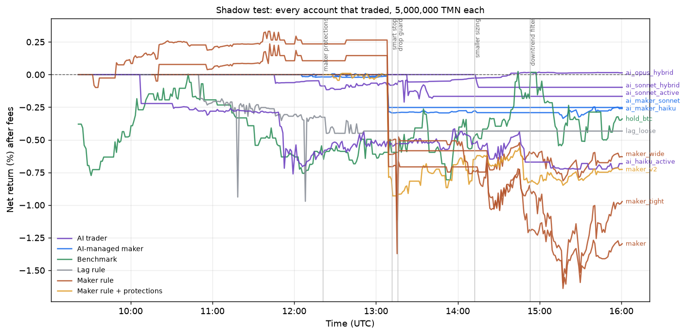

# Results: backtest and shadow test

Generated 2026-10-22 16:01 UTC from saved artifacts only (arena ledgers and hash-chained decision logs, backtest outputs, git history). Shadow test running since 2026-10-22 09:21 UTC on live Wallex order books; no real orders. Every account started with 5,000,000 TMN and pays Wallex level-1 fees.

## Backtest: Wallex lags the global price

7 days of 1-minute Wallex candles for each eligible TMN market, Binance 1-minute closes and Wallex USDT/TMN. Gap = ln(Wallex / (Binance x USDT/TMN)) minus the market's trailing 24 h median.

| Horizon | Median correlation of gap with the next Wallex move | Markets |
|---|---:|---:|
| 5 min | -0.367 | 29 |
| 15 min | -0.388 | 29 |
| 60 min | -0.314 | 29 |
| 240 min | -0.181 | 29 |

Market buy on a dip below fair value, limit sell back at fair value (0.30 % taker in, 0.25 % maker out, full live spread paid on entry). Best parameter sets, all markets pooled:

| Gap threshold | Exit edge | Stop | Max hold | Trades | Sum of per-trade returns | Markets positive |
|---:|---:|---:|---:|---:|---:|---:|
| 1.2% | 0.2% | 4% | 120 min | 53 | +21.3% | 8/10 |
| 1.2% | 0.2% | 2% | 120 min | 54 | +18.6% | 8/10 |
| 0.8% | 0.2% | 4% | 120 min | 215 | +14.9% | 8/14 |
| 0.8% | 0.2% | 2% | 120 min | 218 | +9.0% | 8/14 |
| 1.2% | 0.0% | 4% | 120 min | 53 | +8.2% | 6/10 |
| 1.2% | 0.0% | 2% | 120 min | 54 | +5.6% | 6/10 |

The smallest gaps lose: at a 0.4% threshold the same rule summed to -567.7% over 1340 trades. The parameter grid was evaluated on the same 7 days, so the live shadow test below is the out-of-sample check.

## Shadow test: all strategies on the same live data

Vertical lines mark when each risk change was deployed (from git history).

| Account | Family | AI model | Return % | Max drawdown % | Closed trades | Profitable | Fees (TMN) |
|---|---|---|---:|---:|---:|---:|---:|
| ai_opus_hybrid | AI trader | claude-opus-5-5 | +0.013 | 0.211 | 1 | 0 | 4,482 |
| lag_strict | Lag rule |  | +0.000 | 0.000 | 0 | 0 | 0 |
| maker_stable | Maker rule + protections |  | +0.000 | 0.000 | 0 | 0 | 0 |
| ai_haiku_solo | AI trader | claude-haiku-5-5 | +0.000 | 0.000 | 0 | 0 | 0 |
| ai_haiku_hybrid | AI trader | claude-haiku-5-5 | +0.000 | 0.000 | 0 | 0 | 0 |
| live_dry_maker | Maker rule |  | +0.000 | 0.000 | 0 | 0 | 0 |
| ai_sonnet_hybrid | AI trader | claude-sonnet-5-5 | -0.098 | 0.098 | 1 | 0 | 2,385 |
| ai_sonnet_active | AI trader | claude-sonnet-5-5 | -0.167 | 0.186 | 1 | 0 | 4,775 |
| ai_maker_sonnet | AI-managed maker | claude-sonnet-5-5 | -0.252 | 0.260 | 2 | 1 | 2,845 |
| ai_maker_haiku | AI-managed maker | claude-haiku-5-5 | -0.259 | 0.336 | 3 | 0 | 5,111 |
| hold_btc | Benchmark |  | -0.320 | 0.810 | 0 | 0 | 14,207 |
| lag_loose | Lag rule |  | -0.433 | 0.971 | 1 | 0 | 6,318 |
| maker_wide | Maker rule |  | -0.626 | 1.113 | 3 | 2 | 13,373 |
| ai_haiku_active | AI trader | claude-haiku-5-5 | -0.683 | 0.762 | 4 | 0 | 19,035 |
| maker_v2 | Maker rule + protections |  | -0.721 | 0.939 | 6 | 3 | 17,817 |
| maker_tight | Maker rule |  | -0.953 | 1.825 | 4 | 3 | 27,140 |
| maker | Maker rule |  | -1.291 | 1.964 | 8 | 5 | 30,352 |

## How much the AI was used

| Model | Calls | Mean input tokens | Mean output tokens | Mean cost per decision | Total cost |
|---|---:|---:|---:|---:|---:|
| claude-haiku-5-5 | 317 | 14,083 | 872 | $0.0019 | $0.59 |
| claude-opus-5-5 | 46 | 15,449 | 751 | $0.0790 | $3.63 |
| claude-sonnet-5-5 | 187 | 14,677 | 620 | $0.0364 | $6.81 |

| AI account | Valid decisions | Decisions that changed something |
|---|---:|---:|
| ai_haiku_active | 93 | 6 |
| ai_haiku_hybrid | 97 | 0 |
| ai_haiku_solo | 92 | 0 |
| ai_maker_haiku | 35 | 35 |
| ai_maker_sonnet | 35 | 35 |
| ai_opus_hybrid | 46 | 4 |
| ai_sonnet_active | 93 | 1 |
| ai_sonnet_hybrid | 59 | 2 |

## Log integrity

| Account | Decision-log records | Hash chain |
|---|---:|---|
| ai_opus_hybrid | 134 | verified |
| lag_strict | 26 | verified |
| maker_stable | 14 | verified |
| ai_haiku_solo | 118 | verified |
| ai_haiku_hybrid | 123 | verified |
| live_dry_maker | 6,203 | verified |
| ai_sonnet_hybrid | 91 | verified |
| ai_sonnet_active | 153 | verified |
| ai_maker_sonnet | 2,200 | verified |
| ai_maker_haiku | 2,984 | verified |
| hold_btc | 28 | verified |
| lag_loose | 106 | verified |
| maker_wide | 7,643 | verified |
| ai_haiku_active | 141 | verified |
| maker_v2 | 6,525 | verified |
| maker_tight | 8,231 | verified |
| maker | 5,889 | verified |
